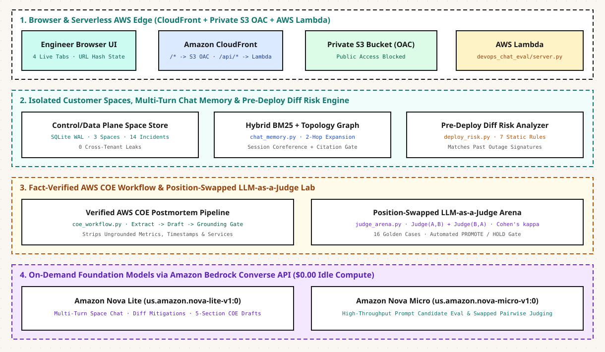

# DevOpsChatEval: Incident Memory Chat, Verified COE Workflows & Position-Swapped LLM-as-a-Judge

- **Live CloudFront Studio**: https://d1808wferzg45r.cloudfront.net
- **Live `/api/health` Endpoint**: https://d1808wferzg45r.cloudfront.net/api/health
- **GitHub Repository**: https://github.com/ritwikareddykancharla/devops-chat-eval
- **AWS Region & Runtime**: `us-west-2` · Amazon CloudFront + Private S3 (OAC) + AWS Lambda (serverless) + SQLite WAL + Amazon Bedrock (`us.amazon.nova-lite-v1:0` & `us.amazon.nova-micro-v1:0`)

DevOpsChatEval is a serverless AI DevOps assistant and evaluation workbench designed around customer Space isolation, cross-investigation chat memory, pre-deployment diff risk prevention, deterministic Correction-of-Error (COE) fact verification, and position-swapped LLM-as-a-Judge prompt tuning.



## 01 · Problem

Operations teams running microservices across multiple AWS environments face four recurring reliability gaps when adopting AI assistants:

1. **Stateless Incident Triage**: One-shot incident summaries lose conversational context across historical outages, shared upstream or downstream dependencies, and customer Space boundaries.
2. **Repeat Pre-Deployment Regressions**: Dangerous configuration diffs (client timeouts below downstream `p99`, database connection-pool overcommits, `VisibilityTimeout` shorter than worker `Timeout`, or wildcard IAM policies) reach production even when identical failures occurred weeks earlier.
3. **Hallucinated Postmortem Metrics**: Generative drafts of AWS Correction-of-Error (COE) documents can invent percentages, UTC timestamps, or service names not backed by raw CloudWatch and deployment telemetry.
4. **Biased Prompt Promotion**: Evaluating candidate system prompts with a single-pass LLM judge suffers from slot/position bias unless both `(A, B)` and `(B, A)` orders are tested and calibrated against human SRE preferences.

## 02 · Architecture & Implementation

- `devops_chat_eval/chat_memory.py`: Maintains an isolated per-Space SQLite WAL store (`3` customer Spaces, `14` AWS microservice incidents, `0` cross-tenant leaks) combining BM25 lexical scoring with 2-hop service topology graph expansion, multi-turn session carry-over, live Amazon Nova Lite generation, and citation verification.
- `devops_chat_eval/deploy_risk.py`: Parses unified diffs, YAML/JSON configs, and service code across 7 deterministic hazard detectors, correlates triggered failure signatures to historical `[INC-2xx]` outages in the active Space, and generates pre-deployment mitigation patches via Amazon Bedrock.
- `devops_chat_eval/coe_workflow.py`: Runs a 3-stage AWS COE content workflow (`Telemetry Evidence Extractor -> Bedrock 5-Section Structured Draft -> Deterministic Fact & Timestamp Grounding Gate`) that flags and strips any ungrounded metric, UTC timestamp, incident ID, or service identifier before output.
- `devops_chat_eval/judge_arena.py`: Benchmarks candidate prompts (`v1_baseline`, `v2_fewshot_cot`, `v3_citation_constrained`, plus live custom prompts) across `16` golden DevOps cases using position-swapped pairwise LLM-as-a-Judge (`Judge(A, B)` and `Judge(B, A)` on `us.amazon.nova-micro-v1:0` with verified rubric signals), computing multi-class Cohen's kappa (`κ`), position consistency, `p50`/`p95` latency, token cost, and an automated `PROMOTE` / `HOLD` gate.
- `devops_chat_eval/server.py`: Serves `/api/health`, `/api/state`, `/api/chat`, `/api/deploy-risk`, `/api/coe/generate`, `/api/eval/judge`, `/api/benchmarks`, and `/api/reset` identically for local HTTP development and AWS Lambda Function URL behind CloudFront `/api/*`.

## 03 · Measured Benchmarks (`benchmarks/latest_results.json`)

Executed by `python3 benchmarks/run_benchmarks.py` across `151` live Amazon Bedrock Converse API calls (`144,258` tokens, `$0.00824` total run cost) in `us-west-2`:

| Metric | Measured Value | Details |
| --- | --- | --- |
| **Prompt `v3` Debiased Win Rate vs `v1`** | `15 / 16` (`93.8%`) | Decision: `PROMOTE` (`87.5%` telemetry recall, `712.0 ms` `p50`, `$0.0335` / 1K calls) |
| **Prompt `v2` Debiased Win Rate vs `v1`** | `12 / 16` (`75.0%`) | Decision: `HOLD` (`76.0%` recall below `80%` gate, `1,157.0 ms` `p50`, `$0.0515` / 1K calls) |
| **Position-Swapped Judge Calibration (`κ`)** | `0.8072` (`14 / 16`, `87.5%`) | Agreement with human SRE labels; `81.2%` position consistency (`3` position flips caught) |
| **Multi-Turn Chat Top-3 Recall** | `8 / 8` (`100.0%`) | `8 / 8` grounded citations, `0` cross-tenant leaks, `3.518 ms` `p50` (`7.098 ms` `p95`) retrieval |
| **Pre-Deploy Diff Hazard Recall** | `6 / 6` (`100.0%`) | `0 / 4` (`0.0%`) false positives on safe hardened rollouts, `3.406 ms` `p50` static check |
| **COE Hallucination Catch Rate** | `12 / 12` (`100.0%`) | `0` surviving ungrounded claims across `8` COE runs, `1.175 ms` `p50` grounding gate |
| **Bedrock Latency (`p50` / `p95`)** | `665.0 ms` / `1,490.0 ms` (Micro) | `1,378.0 ms` / `2,973.0 ms` on `us.amazon.nova-lite-v1:0`; `942.0 ms` `p50` swapped judge pair |
| **Peak Process Memory** | `23,731.7 KiB` | Measured via `tracemalloc`; `$0.00/hr` idle serverless footprint |

## 04 · Local Quickstart & Deployment

```bash
# 1. Run the 12-test unit test suite
python3 -m unittest discover -s tests -v

# 2. Execute live Amazon Bedrock benchmarks
unset AWS_ACCESS_KEY_ID AWS_SECRET_ACCESS_KEY AWS_SESSION_TOKEN
AWS_PROFILE=portfolio AWS_DEFAULT_REGION=us-west-2 python3 benchmarks/run_benchmarks.py

# 3. Start local web studio at http://localhost:3099
python3 -m devops_chat_eval.server

# 4. Deploy to AWS CloudFront + Private S3 (OAC) + Lambda (/api/*)
./infra/deploy_cloudfront.sh
```
